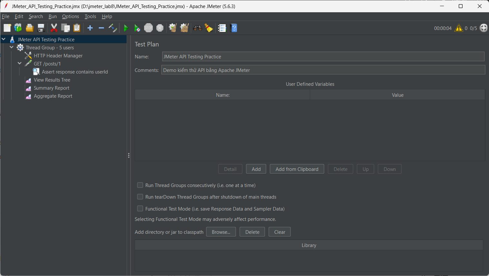
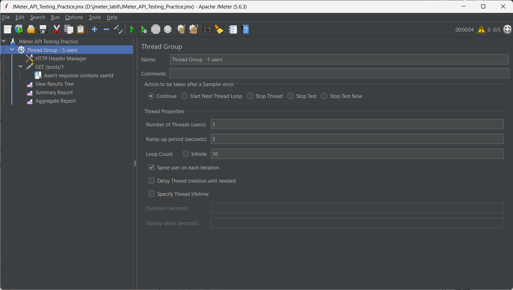
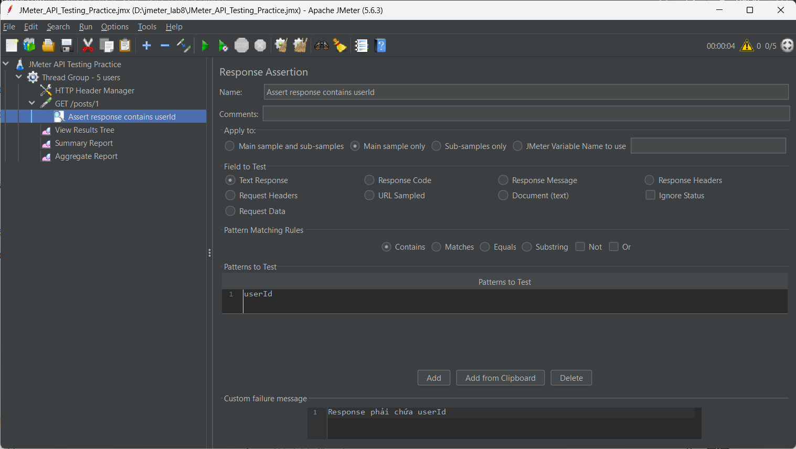
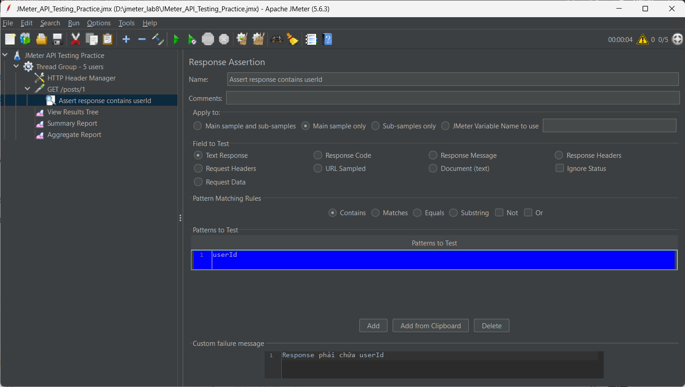
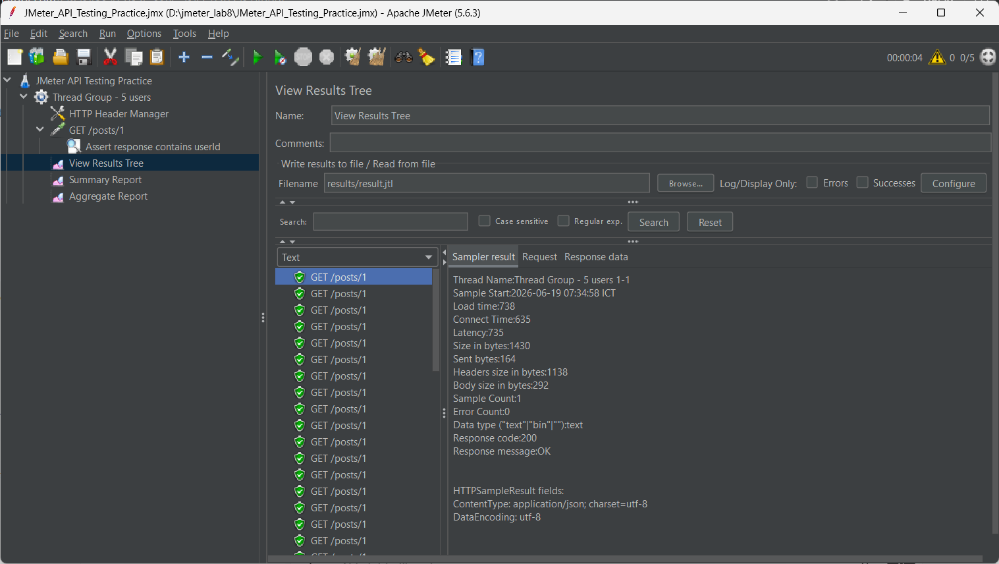
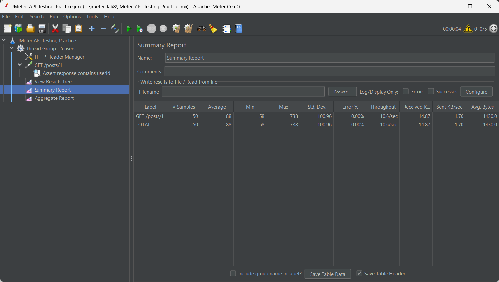
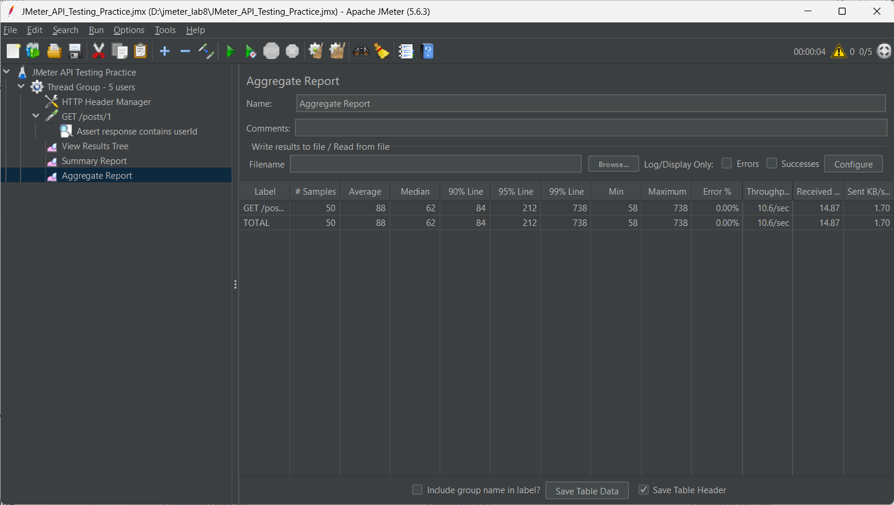

# Báo cáo thực hành kiểm thử hiệu năng bằng Apache JMeter

## 1. Thông tin sinh viên

- Họ và tên: Phạm Văn Đạt
- Mã sinh viên: 23017150

## 2. Mục tiêu bài thực hành

Bài thực hành nhằm tìm hiểu công cụ Apache JMeter và áp dụng để kiểm thử một API web đơn giản. Nội dung chính của bài gồm:

- Tạo một Test Plan trong Apache JMeter.
- Cấu hình Thread Group để mô phỏng nhiều người dùng ảo.
- Tạo HTTP Request gửi yêu cầu đến API demo.
- Thêm Response Assertion để kiểm tra nội dung phản hồi.
- Quan sát kết quả kiểm thử bằng các Listener.
- Lưu test plan, ảnh minh họa và file kết quả để nộp bài.

## 3. Công cụ sử dụng

- Apache JMeter
- Java JDK
- Git và GitHub
- API demo: `https://jsonplaceholder.typicode.com/posts/1`

## 4. Giới thiệu Apache JMeter

Apache JMeter là công cụ mã nguồn mở dùng để kiểm thử hiệu năng, kiểm thử tải và kiểm thử chức năng ở mức cơ bản cho các hệ thống web/API. JMeter cho phép mô phỏng nhiều người dùng cùng truy cập hệ thống, gửi request đến server và thu thập các thông số như thời gian phản hồi, số lượng request thành công/thất bại, độ trễ và throughput.

Trong JMeter, một Test Plan thường có các thành phần chính:

- **Thread Group**: mô phỏng số lượng người dùng ảo.
- **Sampler**: gửi request đến hệ thống, ví dụ HTTP Request.
- **Assertion**: kiểm tra phản hồi có đúng điều kiện mong đợi không.
- **Listener**: hiển thị hoặc lưu kết quả kiểm thử.

## 5. Kịch bản kiểm thử

Bài thực hành sử dụng API công khai JSONPlaceholder để kiểm thử request lấy thông tin một bài viết.

| Thành phần | Giá trị |
|---|---|
| Method | `GET` |
| Protocol | `https` |
| Domain | `jsonplaceholder.typicode.com` |
| Path | `/posts/1` |
| URL đầy đủ | `https://jsonplaceholder.typicode.com/posts/1` |
| Điều kiện kiểm tra | Response chứa chuỗi `userId` |

Cấu hình Thread Group:

| Thành phần | Giá trị |
|---|---:|
| Number of Threads | 5 |
| Ramp-up Period | 5 giây |
| Loop Count | 10 |
| Tổng số request dự kiến | 50 |

## 6. Các bước cấu hình trong JMeter

### Bước 1: Tạo Test Plan

Tạo Test Plan với tên `JMeter API Testing Practice`.

### Bước 2: Cấu hình Thread Group

Thread Group được cấu hình với 5 người dùng ảo, thời gian ramp-up là 5 giây và mỗi người dùng lặp 10 lần.

### Bước 3: Tạo HTTP Request

HTTP Request được cấu hình để gửi request `GET` đến API `jsonplaceholder.typicode.com/posts/1`.

### Bước 4: Thêm Response Assertion

Response Assertion được dùng để kiểm tra phản hồi trả về có chứa chuỗi `userId`.

### Bước 5: Quan sát kết quả bằng Listener

Các Listener được sử dụng để xem kết quả gồm View Results Tree, Summary Report và Aggregate Report.

## 7. Kết quả thực hiện

Sau khi thực hiện kiểm thử, JMeter gửi tổng cộng 50 request đến API demo. Các request đều trả về mã phản hồi `200 OK`, Response Assertion kiểm tra chuỗi `userId` thành công và không ghi nhận lỗi.

| Chỉ số | Kết quả |
|---|---:|
| Samples | 50 |
| Thành công | 50 |
| Thất bại | 0 |
| Error % | 0.00% |
| Average | 73.84 ms |
| Min | 58 ms |
| Max | 219 ms |
| Latency trung bình | 73.66 ms |
| Throughput | 10.63 request/giây |

File kết quả được lưu tại `results/result.jtl`.

## 8. Nhận xét

Qua bài thực hành, em đã hiểu cách tạo một Test Plan cơ bản trong Apache JMeter, biết cấu hình người dùng ảo bằng Thread Group, gửi HTTP Request đến API, kiểm tra phản hồi bằng Assertion và xem kết quả bằng Listener.

Kết quả kiểm thử cho thấy API demo phản hồi ổn định trong phạm vi bài thực hành. Tất cả request đều thành công, tỷ lệ lỗi bằng 0% và thời gian phản hồi trung bình thấp. Điều này cho thấy API đáp ứng tốt với kịch bản kiểm thử nhỏ gồm 5 người dùng ảo và 50 request.

